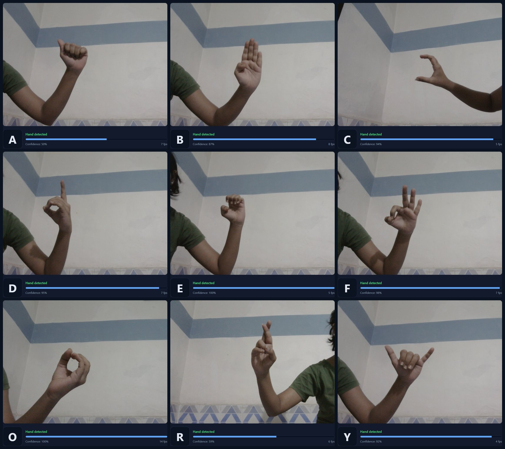

# Real-Time Sign Language Recognition (MobileNet + MediaPipe)

Recognises American Sign Language (ASL) letters **A–Z** from a webcam in real time. MediaPipe finds and tracks the hand, and a MobileNetV2 classifier predicts the letter.

### 👉 [Live demo: try it in your browser](https://kiranshinde24.github.io/Real-time-Sign-Language-Recognition-using-MobileNet-Mediapipe/)

It runs entirely on your device, so no video is uploaded. Open it in Chrome or Edge, press **Start camera**, and show a sign.



*Screenshots from the live demo: A, B, C / D, E, F / O, R, Y.*

## Features

- Real-time hand tracking with MediaPipe Hands
- 26-class ASL letter classifier (MobileNetV2, transfer learning)
- Two ways to run it: a **browser demo** (TensorFlow.js, hosted on GitHub Pages) and a **local Python script** (OpenCV)
- Prediction smoothing over the last few frames, with a "not sure" state under 50% confidence

## How It Works

1. The webcam frame is mirrored, like a selfie view.
2. MediaPipe detects the hand and returns 21 landmarks.
3. A bounding box around the landmarks (plus a margin) is cropped and resized to 224×224.
4. The crop is scaled to 0–1 and passed to the MobileNetV2 model.
5. The predicted letter and confidence are drawn on screen.

## Model and Results

**Dataset:** [ASL Alphabet (Kaggle, grassknoted)](https://www.kaggle.com/datasets/grassknoted/asl-alphabet), using the 26 letter classes (`nothing`, `space` and `del` removed). 62,400 training and 15,600 validation images at 224×224 (80/20 split).

**Backbone comparison** (frozen ImageNet base, same classifier head, 10 epochs, see `Sign_Language.ipynb`):

| Model | Validation accuracy |
|-------|--------------------|
| EfficientNetB0 | 3.85% (did not learn) |
| ResNet50 | 19.60% |
| **MobileNetV2** | **84.29%** (train 97.0%) |

**Shipped model (`asl_model.h5`):** MobileNetV2 + GlobalAveragePooling + Dropout(0.5) + Dense(128) + softmax(26), trained in `Untitled0.ipynb`. Its saved training history shows roughly 81% validation accuracy.

**Live check:** in the browser demo, A, B, C, D, E, F, O, R and Y were all recognised correctly at about 4–14 fps on a laptop webcam, with confidence between 50% and 100%. This was an informal test of one signer in one room, not a benchmark.

> The validation set is a random split of the same dataset (same signers and backgrounds), so these numbers are optimistic for real webcams.

## Project Structure

```
├── docs/                 # browser demo (served by GitHub Pages)
│   ├── index.html        #   TensorFlow.js + MediaPipe Hands app
│   └── model/            #   model converted to TensorFlow.js format
├── realtime_asl.py       # real-time webcam inference (run locally)
├── asl_model.h5          # trained Keras model
├── Sign_Language.ipynb   # backbone comparison (EfficientNetB0 / ResNet50 / MobileNetV2)
├── Untitled0.ipynb       # training run that produced asl_model.h5
├── requirements.txt
└── Screenshots/
```

## Run Locally (Python)

```bash
git clone https://github.com/kiranshinde24/Real-time-Sign-Language-Recognition-using-MobileNet-Mediapipe.git
cd Real-time-Sign-Language-Recognition-using-MobileNet-Mediapipe

python -m venv venv
# Windows: venv\Scripts\activate    |   macOS/Linux: source venv/bin/activate

pip install -r requirements.txt
python realtime_asl.py
```

Press `q` to quit. Use Python 3.10–3.12. Versions are pinned on purpose: the newest `mediapipe` releases no longer include the `mp.solutions` API this script uses.

## Run the Web Demo Locally

Browsers only allow camera access on HTTPS or `localhost`, so serve the folder instead of opening the file directly:

```bash
cd docs
python -m http.server 8000
```

Then open http://localhost:8000.

## Limitations

- **Lighting:** poor or uneven lighting reduces accuracy.
- **Background:** the model was trained on plain backgrounds, so clutter or skin-toned objects can confuse it.
- **J and Z:** these letters involve motion, and a single-frame classifier cannot capture it, so they are unreliable.
- **Similar shapes:** letters such as A, E, M, N and S look alike and may be confused, especially at low confidence.
- **One hand, static signs:** only one hand is tracked, and there is no word or sentence recognition.

## Future Work

- Sequence model (LSTM or temporal CNN) to handle J and Z
- Train on more varied backgrounds, lighting and signers
- Evaluate on a held-out set of different signers, with a confusion matrix
- Word and sentence formation

## Tech Stack

Python, TensorFlow/Keras, MobileNetV2, MediaPipe Hands, OpenCV, TensorFlow.js, JavaScript, GitHub Pages

## Author

**Kiran Shinde** · [GitHub](https://github.com/kiranshinde24)

## License

Released under the [MIT License](LICENSE).
